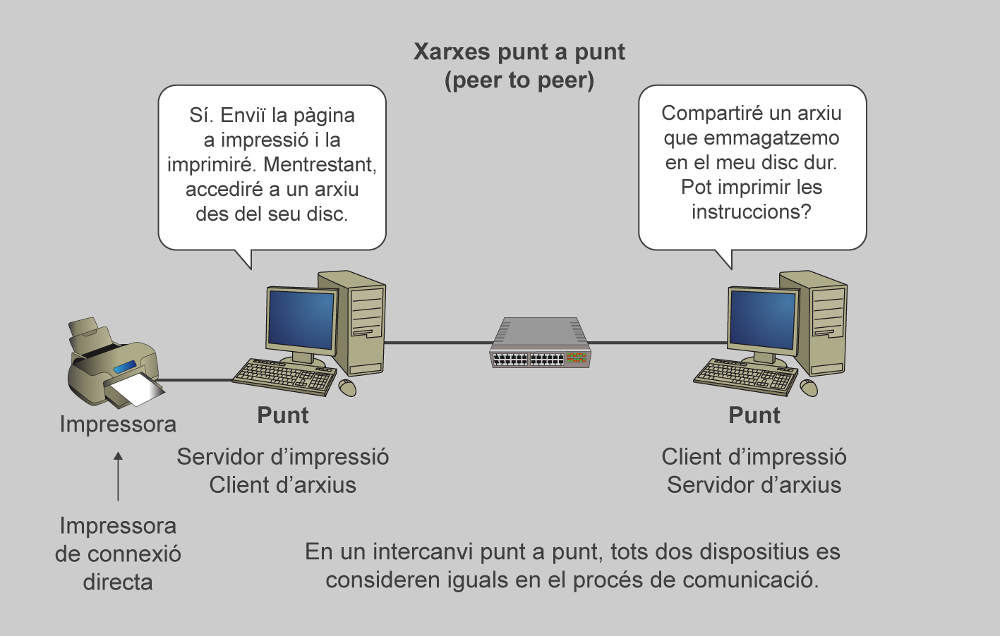

# Operació NordTec
### Elia Tortell Arcos, 1 ASIX B
---
## Índex:
### Recursos
- [Guía de sintaxi Markdown](https://educaciodigital.cat/iticbcn/moodle/mod/url/view.php?id=77603)
- [hackmd.io (markdown)](https://educaciodigital.cat/iticbcn/moodle/mod/url/view.php?id=77603)
- [Activitat: Esquema README.md](https://educaciodigital.cat/iticbcn/moodle/mod/page/view.php?id=78294)
- [Validador YAML](https://educaciodigital.cat/iticbcn/moodle/mod/page/view.php?id=78294)
### Activitats
- [Enunciat](https://educaciodigital.cat/iticbcn/moodle/mod/page/view.php?id=78294)
- [Fase 1](https://educaciodigital.cat/iticbcn/moodle/mod/page/view.php?id=78299)
---
## Estat del projecte
| Tasques                | Estat de la tasca |
| ---------------------- | ----------------- |
| Títol                  | Tasca feta        |
| Índex                  | Tasca feta        |
| Estat del projecte     | Tasca feta        |
| Arquitectura de xarxa  | Tasca feta        |
| Configuracions         | Tasca pendent     |
| Incidències i solucions| Tasca pendent     |
| Missatge d'error       | Tasca pendent     |
| Quan: fase i context   | Tasca pendent     |
| Causa: per què passava | Tasca pendent     |
| Solució: què vam fer   | Tasca pendent     |
| Detectada per:         | Tasca pendent     |
| Decisions tècniques    | Tasca pendent     |
| Reflexions tècniques   | Tasca pendent     |
--- 
## Arquitectura de xarxa

### Dia 1
- Instal·lació de VisualStudio Code
- Instal·lació de Git
- Creació de repositori del projecte
- Creació de l'estructura de carpetes
### Dia 2
### Dia 3
---
# **Elia**
## *nivell 2*
## nivell 2
---
# Pasos per a pujar un canvi a Github
1. comanda "git add ."
2. comanda "git commit -m "missatge" "
3. comanda "git push -u origin main"
---
## [Link](https://docs.github.com/en/get-started/writing-on-github/getting-started-with-writing-and-formatting-on-github/basic-writing-and-formatting-syntax?utm_source=chatgpt.com#styling-text) comandes d'avui
---
# Taula comandes
| Comandes Git  | Funcions                       |
| ------------- | ------------------------------ |
| Git status    | Veure estat del fitxer         |
| Git add       | Afegir el fitxer per pujar     |
| Git commit    | Posar missatge per identificar |
| Git push      | Pujar el fitxer a github       |
| Git init      | Per a crear un respositori     |
---
